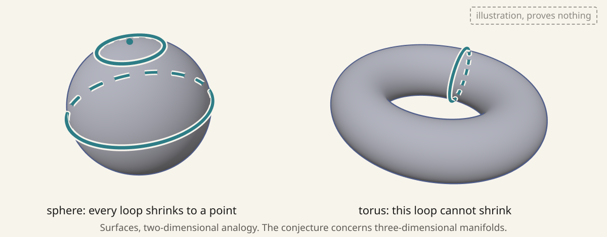
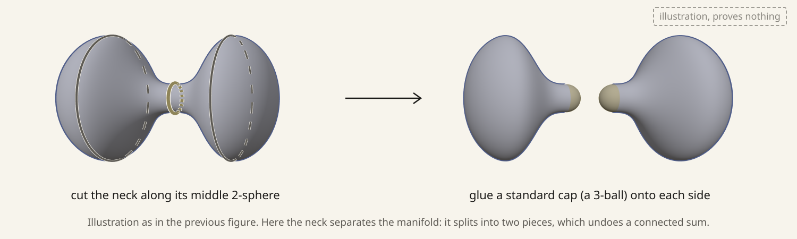
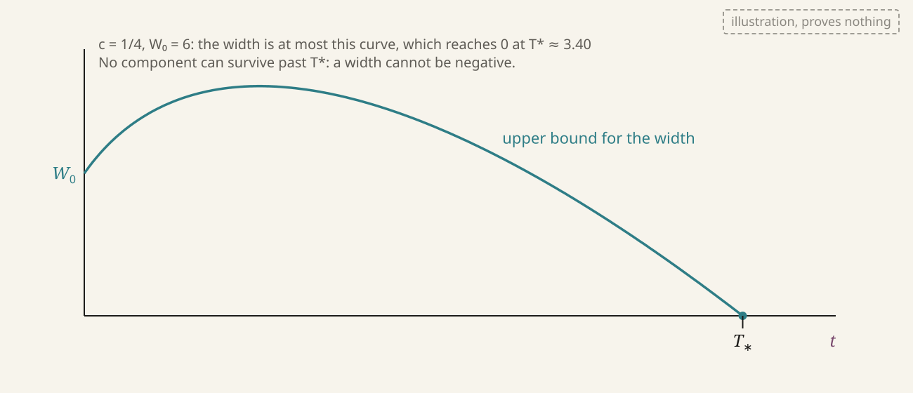
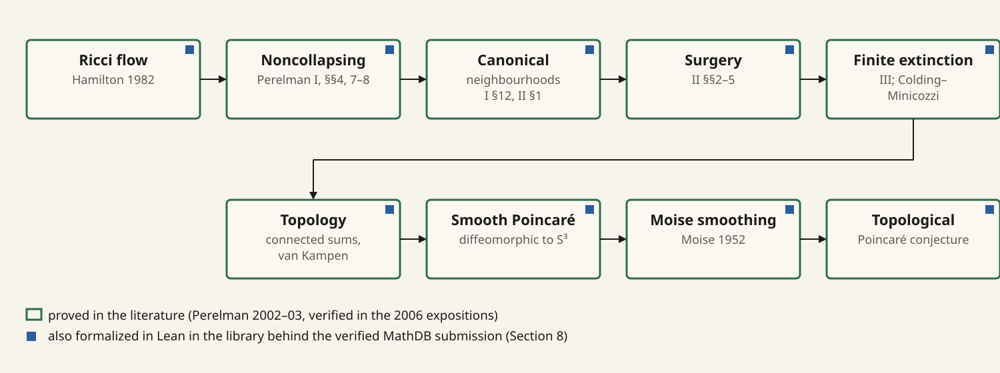
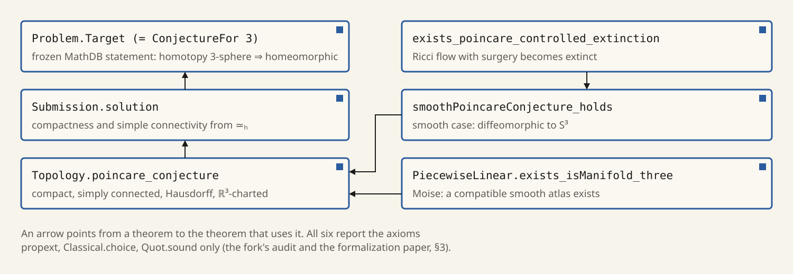

# Summary {-}

In 1904 Henri Poincaré asked whether a closed, connected three-dimensional manifold on which every loop can be shrunk to a point must be the three-dimensional sphere [@Poincare1904; @Milnor2004]. The answer is yes. Grisha Perelman proved it in three preprints posted in 2002 and 2003 [@Perelman2002; @Perelman2003surgery; @Perelman2003extinction], completing a programme that Richard Hamilton had begun in 1982 with the Ricci flow [@Hamilton1982]. Perelman's papers were never submitted to a journal. They were checked in detail by several teams, whose expositions appeared in 2006 [@KleinerLott2008; @MorganTian2007; @CaoZhu2006], and in 2010 the Clay Mathematics Institute awarded Perelman its Millennium Prize for the resolution of the conjecture [@Clay2010]. The proof is accepted by the mathematical community; this acceptance rests on those expositions and on years of scrutiny, as the Clay announcement says.

In 2026 the proof was formalized in the Lean 4 proof assistant, on top of the Mathlib library [@QinEtAl2026; @DGrepo]. A submission fork of that library [@DGfork] proves the problem's frozen formal statement on MathDB [@MathDBTarget], using only Lean's three standard axioms.

This article explains the problem, the proof, and what the formal check does and does not certify. Section 8 reads the formal statement clause by clause. Each claim carries one of three labels, which the accompanying film uses as colours:

- **proved**: proved in the published literature, or accepted on the basis described above (Perelman's preprints together with the 2006 expositions);
- **Lean**: checked by the Lean kernel, in the precise form stated;
- **heuristic**: an explanation, analogy or picture, which proves nothing.

Definitions and history are not labelled. The companion file `CLAIMS.md` lists every mathematical claim of this article with its source and its label.

**What is ours.** The mathematics in this article is due to the authors cited. Our contribution is the exposition itself (its selection, order, explanations and figures) and the clause-by-clause reading of the formal statement in Section 8, which we made from the Lean source. This article has not been peer reviewed.

Prepared by Yao Xu with AI assistance; the narration voice is synthesized with an OpenAI speech model.

# 1. The question

## 1.1 Manifolds and the sphere

A *three-dimensional manifold* is a space that looks, near each of its points, like ordinary three-dimensional space: every point has a neighbourhood homeomorphic to an open subset of $\mathbb R^3$. We also require two points to have disjoint neighbourhoods (the Hausdorff property). A manifold is *closed* if it is compact and has no boundary. The basic example is the unit sphere
$$
S^3=\{(x,y,z,w)\in\mathbb R^4 : x^2+y^2+z^2+w^2=1\},
$$
the set of points at distance one from the origin of four-dimensional space [@Milnor2004, §1].

A space is *simply connected* if it is path connected and every closed loop in it can be deformed continuously, inside the space, to a point. On the two-dimensional sphere every loop shrinks; on the surface of a doughnut (the torus) a loop around the tube does not (Figure 1). Among closed surfaces, the sphere is the only simply connected one; this follows from the classification of surfaces known in the nineteenth century [@Milnor2004, §1].



## 1.2 Poincaré's question

Poincaré asked the corresponding question one dimension up. In Milnor's modern phrasing [@Milnor2004, §1]:

> If a compact three-dimensional manifold $M^3$ has the property that every simple closed curve within the manifold can be deformed continuously to a point, does it follow that $M^3$ is homeomorphic to the sphere $S^3$?

Four years earlier Poincaré had stated a stronger claim, that a manifold with the homology of a sphere is a sphere; his 1904 paper itself gave the counterexample, a manifold with the homology of $S^3$ but with a nontrivial fundamental group of order 120 [@Milnor2004, §2]. The fundamental group is therefore the right test, and the hypothesis that it vanishes is the hypothesis of the conjecture. In short:

**Poincaré conjecture.** Every closed, simply connected three-dimensional manifold is homeomorphic to $S^3$.

An equivalent form uses homotopy equivalence instead of simple connectivity. A closed simply connected three-manifold is homotopy equivalent to $S^3$, by Poincaré duality, the Hurewicz theorem and Whitehead's theorem [@Hatcher2002, §4.2, Exercise 15]; conversely a closed manifold homotopy equivalent to $S^3$ is simply connected. The formal statement checked on MathDB uses the homotopy form (Section 8).

## 1.3 Higher dimensions first

The analogous statement in dimension $n$ (a closed $n$-manifold homotopy equivalent to $S^n$ is homeomorphic to $S^n$) was proved first in high dimensions. Smale proved it for smooth manifolds of dimension at least five in 1961 [@Smale1961], and Freedman proved the four-dimensional topological case in 1982 [@Freedman1982]; Milnor's account explains why these dimensions were easier: in dimension five or more, two-dimensional discs can be moved off each other, and in dimensions three and four they cannot [@Milnor2004, §3]. Dimension three was the last case. One relative of the question remains open: whether every smooth four-manifold homotopy equivalent to $S^4$ is *diffeomorphic* to $S^4$, the smooth Poincaré conjecture in dimension four [@Milnor2004, §3]. Mathlib's statement file still lists dimension four as open for the smooth version [@Mathlib, `Geometry/Manifold/PoincareConjecture.lean`].

In dimension three the topological, piecewise-linear and smooth categories agree: every topological three-manifold has a smooth structure, unique up to diffeomorphism, and homeomorphic smooth three-manifolds are diffeomorphic. Moise proved that every three-manifold can be triangulated, essentially uniquely [@Moise1952; @Moise1977]; the passage from triangulations to smooth structures is due to Whitehead and Munkres [@Milnor2004, §3; @MorganTian2007, Introduction, footnote 1]. Following common usage and the formalization, we call the result Moise's theorem. So it is enough to prove the conjecture for smooth manifolds, and that is how the Ricci flow proof proceeds: it shows that a smooth, closed, simply connected three-manifold is *diffeomorphic* to $S^3$, and Moise's theorem supplies the smooth structure.

## 1.4 Geometrization

In 1982 Thurston proposed a far-reaching conjecture: every closed orientable three-manifold can be cut along spheres and tori into pieces that each carry one of eight model geometries [@Thurston1982; @Milnor2004, §4]. The Poincaré conjecture is a special case of its *elliptization* part, which says that a closed three-manifold with finite fundamental group is a quotient of $S^3$ by a finite group of rotations acting freely. Perelman's work proves the full geometrization conjecture [@Clay2010]; this article follows only the shorter route to the Poincaré conjecture, which avoids the long-time analysis that geometrization needs [@KleinerLott2008, §1].

# 2. Ricci flow and Hamilton's programme

## 2.1 The equation

Let $M$ be a closed three-manifold with a Riemannian metric $g$, which measures lengths and angles. From $g$ and its first two derivatives one computes the Ricci curvature, a symmetric two-tensor $\mathrm{Ric}$, and its trace, the scalar curvature $R$. Hamilton's *Ricci flow* deforms the metric in time $t$ by
$$
\frac{\partial g}{\partial t}=-2\,\mathrm{Ric}.
$$
The metric shrinks in directions of positive curvature and expands in directions of negative curvature [@Milnor2004, §5]. In suitable coordinates this is a nonlinear heat equation for the metric, and like the heat equation it tends to spread curvature out (**heuristic**; the precise statements follow).

The round sphere shows the simplest behaviour. On a round $S^3$ of radius $r$ the Ricci tensor is $\mathrm{Ric}=2g/r^2$ [@Milnor2004, §5]. Writing $g=r^2g_1$ with $g_1$ the unit round metric, the flow becomes $\tfrac{d}{dt}r^2=-4$, so $r(t)^2=r(0)^2-4t$: the sphere stays round and shrinks to a point at time $r(0)^2/4$ (**proved**, a direct computation). This finite-time disappearance is what the proof will eventually show must happen to every simply connected example.

## 2.2 Hamilton's theorem and the problem of singularities

Hamilton introduced the flow and proved its first major theorem in 1982: a closed three-manifold that carries a metric of positive Ricci curvature also carries a metric of constant positive curvature, and is therefore a spherical space form $S^3/\Gamma$, the quotient of $S^3$ by a finite group of rotations acting freely; $S^3$ itself is only the case of trivial $\Gamma$ [@Hamilton1982; @Milnor2004, §§4–5] (**proved**). Under the flow normalized to keep the volume fixed, such metrics converge smoothly, as time goes to infinity, to a metric of constant positive curvature.

For a general initial metric the flow can develop singularities in finite time: the curvature becomes unbounded somewhere. (It need not: on a flat three-torus the metric does not change at all.) The typical example is a *neck pinch*. Figure 2 illustrates a rotationally symmetric metric on $S^3$ as a surface of revolution: each circle across the surface stands for a two-sphere of that radius. If the middle is thin, the two-spheres there shrink to a point before the ends do.


Hamilton's programme was to continue the flow through such singularities by *surgery*: cut the manifold along a thin neck, cap off the two ends, and restart the flow. He developed surgery for compact four-manifolds with positive isotropic curvature and no essential incompressible space forms [@Hamilton1997, Theorem 1.1] (gaps in that argument were later filled by Chen and Zhu [@ChenZhu2006]), and proved several of the estimates the three-dimensional programme needed: the Hamilton–Ivey pinching estimate, which says that where the curvature is large it is almost positive [@Hamilton1995sing; @Ivey1993]; a compactness theorem for sequences of flows [@Hamilton1995compact]; a differential Harnack inequality [@Hamilton1993Harnack]; and the analysis of non-singular solutions [@Hamilton1999]. What was missing was control of the singularities themselves. Two obstacles stood out [@Perelman2002, introduction; @Clay2010]:

1. **Collapsing.** A blow-up limit near a singularity might collapse: balls might have curvature bounded at their own scale but tiny volume, so that no smooth limit exists.
2. **Classification.** Even with limits, one needed to know which shapes can occur near a singularity, so that the surgery could be done in a standard way, and one needed to know that surgery times do not accumulate.

Perelman removed both.

# 3. Perelman's monotonicity and noncollapsing

## 3.1 An entropy that only increases

Perelman found that Ricci flow is, up to diffeomorphisms, the gradient flow of a functional [@Perelman2002, §1]. The version used for noncollapsing is the $\mathcal W$-entropy [@Perelman2002, (3.1)]: for a metric $g$ on an $n$-manifold, a function $f$ and a scale $\tau>0$,
$$
\mathcal W(g,f,\tau)=\int_M\bigl[\tau(|\nabla f|^2+R)+f-n\bigr](4\pi\tau)^{-n/2}e^{-f}\,dV,
\qquad \int_M(4\pi\tau)^{-n/2}e^{-f}\,dV=1 .
$$
The monotonicity holds only under a coupled evolution [@Perelman2002, (3.3)]: $g$ evolves by Ricci flow, the scale by $d\tau/dt=-1$, and $f$ so that $u=(4\pi\tau)^{-n/2}e^{-f}$ solves the conjugate heat equation $\square^*u=(-\partial_t-\Delta+R)\,u=0$, which keeps the normalization $\int u\,dV=1$. Under this coupled evolution [@Perelman2002, (3.4)]
$$
\frac{d\mathcal W}{dt}=\int_M 2\tau\Bigl|R_{ij}+\nabla_i\nabla_j f-\frac{1}{2\tau}g_{ij}\Bigr|^2(4\pi\tau)^{-n/2}e^{-f}\,dV\;\ge\;0 .
$$
So the minimum $\mu(g,\tau)=\inf_f\mathcal W(g,f,\tau)$ is monotone along the flow, and its derivative vanishes only on gradient shrinking solitons (**proved**; [@Perelman2002, §3]; details in [@KleinerLott2008, §§11–12]).

## 3.2 No local collapsing

A metric is *$\kappa$-noncollapsed on the scale $\rho$* if every ball of radius $r<\rho$ on which $|\mathrm{Rm}|\le r^{-2}$ has volume at least $\kappa r^n$ [@Perelman2002, Definition 4.2]. Here $\mathrm{Rm}$ is the full curvature tensor; the definition asks that a ball which looks curvature-wise like a unit ball, after rescaling, also has a definite fraction of a unit ball's volume.

**No local collapsing theorem** [@Perelman2002, Theorem 4.1, Theorem 8.2; @KleinerLott2008, §§13, 26] (**proved**). A Ricci flow on a closed manifold over a finite time interval is $\kappa$-noncollapsed below a fixed scale, with $\kappa>0$ depending on the initial metric, the length of the time interval and the scale.

The idea of the first proof: on a collapsing ball one builds a test function $f$ concentrated on the ball, for which $\mathcal W$ is very negative; monotonicity carries this negativity back to the initial metric at a bounded scale, where $\mu$ is bounded below. Perelman's second proof uses the *reduced volume* [@Perelman2002, §7]. For a space-time path $\gamma$ ending at a point $p$, with backward time $\tau$, its $\mathcal L$-length is $\mathcal L(\gamma)=\int\sqrt\tau\,(R+|\dot\gamma|^2)\,d\tau$; the reduced length is $l(q,\tau)=\mathcal L/(2\sqrt\tau)$ for the shortest such path to $q$, and the reduced volume
$$
\tilde V(\tau)=\int_M\tau^{-n/2}\exp(-l(q,\tau))\,dq
$$
is nonincreasing in $\tau$ [@Perelman2002, §7.1] (**proved**). This local version is the one that survives surgery [@KleinerLott2008, §§78–79].

# 4. Singularities, κ-solutions and canonical neighbourhoods

## 4.1 Blow-ups and ancient κ-solutions

Near a point where the curvature is very large, rescale the metric so that the curvature there becomes one, and shift time so that this moment is $t=0$. Because of noncollapsing and Hamilton's compactness theorem, such rescalings converge (along subsequences) to a limit flow. The limit is defined for all negative times, so it is *ancient*; by the Hamilton–Ivey pinching estimate it has nonnegative curvature; and it inherits noncollapsing. (This paragraph is a **heuristic** sketch of the argument in [@Perelman2002, proof of Theorem 12.1].) Perelman calls these limits **ancient κ-solutions**: solutions of Ricci flow on an oriented three-manifold, defined for $-\infty<t\le0$, complete, non-flat, with bounded nonnegative curvature, and $\kappa$-noncollapsed on all scales [@Perelman2003surgery, §1.1; @Perelman2002, §11.1].

**Compactness** [@Perelman2002, Theorem 11.7] (**proved**). The set of non-compact ancient κ-solutions (in three dimensions, with the curvature at a base point normalized to one) is compact.

**Structure** [@Perelman2003surgery, §1.5] (**proved**). For every small $\varepsilon>0$ there are constants $C_1,C_2$ such that every point of every three-dimensional ancient κ-solution has a neighbourhood of one of four kinds: (a) a *strong ε-neck*, close after rescaling to a round cylinder $S^2\times$ interval evolving by Ricci flow; (b) an *ε-cap*, a region diffeomorphic to a three-ball or to a punctured $\mathbb{RP}^3$ whose end is an ε-neck [@KleinerLott2008, §58]; (c) a closed manifold diffeomorphic to $S^3$ or $\mathbb{RP}^3$; (d) a closed manifold of constant positive sectional curvature. Morgan and Tian give a full classification of this kind [@MorganTian2007, Theorem 9.93].

## 4.2 The canonical neighbourhood theorem

The structure of the models transfers back to the original flow.

**Canonical neighbourhood theorem** [@Perelman2002, Theorem 12.1] (**proved**). Given $\varepsilon>0$ and the noncollapsing and pinching data, there is $r_0>0$ such that in a Ricci flow on a closed three-manifold, every point $(x_0,t_0)$ with $t_0\ge1$ and scalar curvature $Q=R(x_0,t_0)\ge r_0^{-2}$ has a parabolic neighbourhood which, after scaling by $Q$, is ε-close to the corresponding piece of an ancient κ-solution.

Combined with Section 4.1, every point of high curvature lies in an ε-neck, an ε-cap, or a closed component of positive curvature (Figure 3). This is the fact that makes surgery possible: the places where the flow becomes singular look, at their own scale, like a few standard shapes.

![The kinds of canonical neighbourhood (**heuristic** illustrations, drawn as surfaces of revolution). Precise statements: [@Perelman2003surgery, §1.5], [@Perelman2002, §12.1].](figures/neighbourhoods.svg)

# 5. Surgery

## 5.1 The construction

Let the flow run until the first singular time $T$. The curvature blows up on part of the manifold; on the rest the metric converges to a smooth limit [@Perelman2003surgery, §3]. By the canonical neighbourhood theorem, the high-curvature region consists of *horns*, long ε-necks ending in the singularity, together with components that are entirely of high curvature.

**Ricci flow with δ-cutoff** [@Perelman2003surgery, §4.4] (**proved**). Fix a small $\delta>0$. In each ε-horn, find a δ-neck of radius $h$, cut it along its middle two-sphere, remove the horn-shaped end, and glue in an almost *standard cap*. Discard the components that are nearly round or entirely of high curvature. Then restart the flow.

The standard cap comes from the *standard solution*, a fixed rotationally symmetric metric of nonnegative curvature on $\mathbb R^3$ that is a cap near the origin and, at infinity, a round cylinder whose cross-sections have scalar curvature one. Perelman proves that its Ricci flow exists on $[0,1)$, is unique, and has canonical neighbourhoods of its own [@Perelman2003surgery, §2, Claims 1–5]. This is what lets the surgery region be controlled after the restart.



A neck need not separate the manifold. In $S^2\times S^1$ the sphere $S^2\times\{\text{point}\}$ is the middle of a neck that does not disconnect it; cutting there and capping both ends leaves one connected piece, a three-sphere. In general, for an orientable $M$, cutting along a separating two-sphere and capping writes $M$ as a connected sum $M_1\#M_2$, and cutting along a non-separating one removes a summand $S^2\times S^1$: $M=M'\#(S^2\times S^1)$ (for a non-orientable $M$ the summand can instead be the non-orientable two-sphere bundle over the circle) (**proved**; standard three-manifold topology, and the list of topology changes in [@MorganTian2007, Theorem 0.3]). This is why $S^2\times S^1$ appears among the pieces in Section 7.

## 5.2 Why surgery can always be continued

Three facts make the construction work for all time.

1. **Finitely many surgeries in finite time.** "Every surgery reduces the volume by at least $h^3$", so "the sequence of surgery times is discrete" [@Perelman2003surgery, §4.4] (**proved**). When the surgery parameters are allowed to depend on time (point 2 below), they stay bounded away from zero on every finite time interval [@Perelman2003surgery, §5.1], so on such an interval each surgery removes at least a fixed amount of volume. Between surgeries the volume can grow only at a bounded rate, because $\tfrac{d}{dt}\mathrm{Vol}=-\int R\,dV$ and $R$ is bounded below (Section 6.3). The volume budget on the interval is therefore finite, and only finitely many surgeries fit in it. This is the answer to the worry that surgery times might accumulate.
2. **The a priori assumptions persist.** The pinching estimate and the canonical neighbourhood property must hold after each surgery, so that the next surgery can be done. Perelman proves this by a choice of decreasing surgery parameters $r(t)$ and $\bar\delta(t)$, and by extending the reduced-volume argument across surgeries [@Perelman2003surgery, §§4–5, summary in §6.1] (**proved**; full details in [@KleinerLott2008, §§68–80], [@MorganTian2007, Theorem 15.9]).
3. **Topology changes only in a known way.** Each surgery is a connected-sum decomposition together with the removal of components diffeomorphic to $S^2\times S^1$, $\mathbb{RP}^3\#\mathbb{RP}^3$, the non-orientable two-sphere bundle over the circle, or a manifold of constant positive curvature [@MorganTian2007, Theorem 0.3] (**proved**).

The result is a *Ricci flow with surgery*, defined for all $t\ge0$, for every initial metric on a closed orientable three-manifold (after scaling the metric to be normalized) [@Perelman2003surgery, §6.1; @MorganTian2007, Theorem 0.3] (**proved**).

# 6. Finite extinction for simply connected manifolds

## 6.1 The statement

**Finite extinction** [@Perelman2003extinction, Theorem 1.1; @ColdingMinicozzi2005, Corollary 1.2 and §4; @MorganTian2007, Theorem 18.1] (**proved**). Let $M$ be a closed orientable three-manifold whose prime decomposition has no aspherical factors; for example, $M$ simply connected. Then for every initial metric the Ricci flow with surgery becomes *extinct* in finite time: from some time on, the manifold is empty.

Extinction means every component has either shrunk away (like the round sphere of Section 2.1) or been discarded at a surgery. The proof measures the manifold with a *width*, shows that the width is forced down at a definite rate, and concludes that it would become negative.

## 6.2 The width

Perelman's width uses loops and the discs they bound [@Perelman2003extinction, §1.1]. For a contractible loop $\gamma$ in $M$, let $A(\gamma)$ be the least area of a disc in $M$ with boundary $\gamma$. A *sweep-out* is a compact family $\Gamma$ of contractible loops (in Morgan–Tian and in the formal proof, a family parametrized by a two-sphere) in a homotopy class $\alpha$ that cannot be represented by constant loops; such a class exists when $M$ is not aspherical, by a classical result of Serre [@Perelman2003extinction, §1.1]. (For a homotopy sphere, $\pi_3(M)\cong\mathbb Z$ supplies it.) The width is
$$
W(g)=\inf_{\Gamma\in\alpha}\;\max_{\gamma\in\Gamma}A(\gamma),
$$
the least possible value of the largest disc area in a sweep-out. It is nonnegative by definition, and nonnegativity is all the extinction argument below uses (Perelman also shows that it is positive [@Perelman2003extinction, §3.1]).

## 6.3 The two inequalities

**Width inequality** [@Perelman2003extinction, Lemma 1.2] (**proved**). If $g(t)$ is a smooth Ricci flow, then for every such class $\alpha$ the width $W(t)$ satisfies
$$
\frac{d}{dt}W(t)\;\le\;-2\pi-\frac12 R_{\min}(t)\,W(t),
$$
in the sense of the lim sup of forward difference quotients, where $R_{\min}(t)$ is the minimum of the scalar curvature at time $t$.

Perelman's explanation is short [@Perelman2003extinction, §1.2] (**heuristic** as stated; the rigorous proof is §3 of the same paper, using a regularization of curve-shortening flow due to Altschuler and Grayson). Let the loops move by curve-shortening flow while the metric moves by Ricci flow. The area of a minimal disc $D$ with boundary $c$ then changes at the rate $\int_D(-\mathrm{tr}\,\mathrm{Ric}^T)+\int_c(-k_g)$. In three dimensions the first integrand is $-\tfrac12R-(K-\det II)$, and $\det II\le0$ on a minimal surface. The Gauss–Bonnet theorem turns $\int_D(-K)+\int_c(-k_g)$ into $-2\pi$. What remains is $\int_D(-\tfrac12R)-2\pi\le-\tfrac12R_{\min}A-2\pi$.

The inequality survives surgery. The surgery maps from the pre-surgery manifold to the post-surgery one are $(1+\xi)$-Lipschitz, with $\xi>0$ as small as we like; for a homotopy sphere they are (almost) distance non-increasing homotopy equivalences onto each post-surgery component, which is "enough to keep track of the nontrivial relative homotopy class of the loop space" [@Perelman2003extinction, §§1.3–1.4]. So the width cannot jump up at a surgery time (**proved**; [@MorganTian2007, Proposition 18.18]).

**Why one deadline holds for every component.** After a surgery the manifold may have several components, and later surgeries split them further. The argument follows one component at a time, backwards. Take any component that is still alive at some time $T$, and trace it back through the surgery history: at each surgery time it came from one component just before the surgery, which came from one earlier component, and so on, back to $M$ at time $0$. Along this chain of *ancestors*, define $W(t)$ as the width of the ancestor alive at time $t$. Between surgeries $W$ satisfies the width inequality. At a surgery time $s$ the comparison map from the ancestor just before $s$ to the one just after it is degree one (or a homotopy equivalence), so it carries the chosen class of loop families to a nontrivial class, and its Lipschitz constant tends to one as the incoming time approaches $s$; hence $W(s)\le\liminf_{t\uparrow s}W(t)$ [@MorganTian2007, Proposition 18.18, and the discussion before it; @QinEtAl2026, §2]. Every surviving component of a simply connected $M$ stays simply connected, so the class exists all along the chain. And every chain starts at the same place: $W(0)=W(M,g_0)=W_0$. So the bound of Section 6.4, which depends only on $W_0$ and $c$, is the same for every component, and no component of any generation survives past it (**proved**; this paragraph follows the formulation of [@QinEtAl2026, §2] and [@MorganTian2007, §18.3]).

**Lower bound for the scalar curvature** (**proved**). Under Ricci flow $\partial_tR=\Delta R+2|\mathrm{Ric}|^2\ge\Delta R+\tfrac23R^2$ [@Perelman2003extinction, §1.3]. By the maximum principle, comparing with the solution of $\tfrac{d}{dt}r=\tfrac23r^2$: if $R\ge-\tfrac{3}{2c}$ at time $0$ for a constant $c>0$, then
$$
R_{\min}(t)\;\ge\;-\frac{3}{2(t+c)}
$$
for all later $t$. Surgery preserves this bound, because surgery is done only where the scalar curvature is large and positive [@KleinerLott2008, Lemma 79.11, with $c=\tfrac14$ for normalized initial metrics; @QinEtAl2026, §2].

## 6.4 Integrating

Insert the lower bound into the width inequality. Since $W\ge0$,
$$
\frac{dW}{dt}\;\le\;-2\pi+\frac{3}{4(t+c)}\,W .
$$
Multiply by the integrating factor $(t+c)^{-3/4}$:
$$
\frac{d}{dt}\Bigl[\frac{W(t)}{(t+c)^{3/4}}\Bigr]\;\le\;-\frac{2\pi}{(t+c)^{3/4}} .
$$
Integrating from $0$ to $t$, and writing $W_0=W(0)$,
$$
0\;\le\;\frac{W(t)}{(t+c)^{3/4}}\;\le\;\frac{W_0}{c^{3/4}}-8\pi\bigl((t+c)^{1/4}-c^{1/4}\bigr).
$$
The right-hand side becomes negative after the time
$$
T_*=\Bigl(c^{1/4}+\frac{W_0}{8\pi c^{3/4}}\Bigr)^4-c ,
$$
so no component carrying the class $\alpha$ survives past $T_*$ (**proved**: this is the computation of [@QinEtAl2026, §2], which we checked line by line; the formal library defines the same number as `extinctionThreshold`). Figure 5 plots the bound for sample values.

Perelman's own paper reaches the conclusion with a cruder but shorter step: $\hat A=A/(t+\mathrm{const})$ satisfies $\tfrac{d}{dt}\hat A\le-2\pi/(t+\mathrm{const})$, whose right-hand side is not integrable at infinity, while $\hat A$ cannot become negative [@Perelman2003extinction, §1.3].



## 6.5 Other versions of the same argument

Colding and Minicozzi gave an independent proof of finite extinction at the same time, using sweep-outs by two-spheres and their energy instead of loops and discs [@ColdingMinicozzi2005, Theorem 1.1 for prime manifolds, Corollary 1.2 in general]. Their inequality is
$$
\frac{d}{dt}W(g(t))\;\le\;-4\pi+\frac{3}{4(t+C)}\,W(g(t)),
$$
again in the sense of the lim sup of forward difference quotients. Here $W$ is a different number from Perelman's width of Section 6.2: the min-max energy of sweep-outs of $M$ by two-spheres [@ColdingMinicozzi2005, (1.2)]. The constant $-4\pi$ instead of $-2\pi$ reflects Gauss–Bonnet for a sphere rather than a disc (**heuristic**). The same integration as in Section 6.4, now with $-4\pi$, gives
$$
\frac{W(t)}{(t+C)^{3/4}}\;\le\;\frac{W(0)}{C^{3/4}}-16\pi\bigl((t+C)^{1/4}-C^{1/4}\bigr),
\qquad\text{so}\qquad t\;\le\;\Bigl(C^{1/4}+\frac{W(0)}{16\pi C^{3/4}}\Bigr)^4-C
$$
for as long as the flow lives (**proved**: our integration of their inequality). The two routes must not be mixed: the loop width goes with $-2\pi$ and $8\pi$, the sphere width with $-4\pi$ and $16\pi$. Colding and Minicozzi later published the full details of the sweep-out construction [@ColdingMinicozzi2008, Theorem 1.7 and Corollary 1.11; the sweep-out construction is Theorem 1.14].

Morgan and Tian follow Perelman's loop version [@MorganTian2007, Proposition 18.18]; for normalized initial metrics they use $R_{\min}(t)\ge-6/(1+4t)$, the case $c=\tfrac14$ above, and solve $w'=-2\pi+3w/(1+4t)$ explicitly [@MorganTian2007, §18.3]. In 2015 they published a correction to the curve-shortening estimates in this part of their book, pointed out by Bahri and Tao, and state that it does not affect the application to the extinction argument [@MorganTian2015]. Kleiner and Lott do not cover finite extinction; they cite [@Perelman2003extinction; @ColdingMinicozzi2005] for this step [@KleinerLott2008, §1].

# 7. The topological conclusion

Run the Ricci flow with surgery on a closed simply connected three-manifold $M$ with any metric. By Section 6 it becomes extinct at a finite time. Read backwards, the surgery history says what $M$ is made of [@MorganTian2007, proof of Theorem 0.1 in Chapter 18] (**proved**):

1. Every component that disappears is either discarded at a surgery or shrinks away, and each such component is a spherical space form $S^3/\Gamma$, $S^2\times S^1$, or one of the few other models of Section 5.2.
2. Each surgery undoes a connected sum. Working backwards from the empty manifold, each earlier time-slice is a disjoint union of connected sums of these pieces [@MorganTian2007, Corollary 15.4]. So $M$ is a connected sum of spherical space forms and copies of $S^2\times S^1$ (orientable case).
3. The fundamental group of a connected sum is the free product of the factors' fundamental groups (van Kampen). Since $\pi_1(M)$ is trivial, every factor is simply connected. $S^2\times S^1$ has fundamental group $\mathbb Z$, and $S^3/\Gamma$ has fundamental group $\Gamma$, so every factor is $S^3$.
4. A connected sum of copies of $S^3$ is $S^3$. So $M$ is diffeomorphic to $S^3$.

This proves the *smooth* Poincaré conjecture: every closed, simply connected, smooth three-manifold is diffeomorphic to $S^3$. Moise's theorem, that every topological three-manifold has a smooth structure [@Moise1952; @Moise1977], gives the topological statement. A homeomorphism between smooth manifolds is in particular a homeomorphism, so the smooth result applied to the smooth structure Moise provides yields a homeomorphism of the original space with $S^3$.

The same argument proves elliptization: a closed three-manifold with finite fundamental group is a spherical space form [@Perelman2003extinction, Remark 1.4; @MorganTian2007, Theorem 0.1].



## 7.1 Status

Perelman's three preprints are not refereed publications. Their arguments were checked and written out in full by Kleiner and Lott (notes posted online as the verification proceeded, a complete version on arXiv in May 2006, later revised and published in *Geometry & Topology* in 2008), by Morgan and Tian (posted in July 2006, published in 2007), and by Cao and Zhu (2006) [@KleinerLott2008; @MorganTian2007; @CaoZhu2006; @Clay2010]. In 2006 the International Mathematical Union awarded Perelman a Fields Medal "for his contributions to geometry and his revolutionary insights into the analytical and geometric structure of the Ricci flow", which he declined [@IMU2006]. The Clay Mathematics Institute's announcement of its 2010 prize states the basis of the verification: "These expositions, those by other teams, and, importantly, the multi-year scrutiny of the mathematical community, provided the needed verification" [@Clay2010, p. 7].

This acceptance is a human judgement about published mathematics. It is separate from the machine check described next, which certifies a formal statement and a formal proof, not Perelman's papers.

# 8. What the Lean formalization states and certifies

## 8.1 The artefacts

- **The library.** Ziyang Qin, Yuan Liao, Ayush Khaitan and Bennett Chow describe a Lean 4 formalization of the smooth three-dimensional Poincaré conjecture, together with Moise's smoothing theorem, "yielding the topological three-dimensional Poincaré conjecture"; the smooth proof "follows the Hamilton–Perelman route through Ricci flow with surgery and finite-time extinction" [@QinEtAl2026, abstract]. The release they fix is DifferentialGeometry v0.1.3, commit `7a48598d`, with Lean and Mathlib v4.33.1 [@QinEtAl2026, §3; @DGrepo]. The library is published under the Apache License 2.0, and its `NOTICE` file lists the vendored sources from other Lean projects.
- **The submission fork** [@DGfork], commit `9f65eaf9` (26 October 2026), adds one file, `Submission.lean`, that proves MathDB's frozen statement, a backport of one bridging theorem from the library's v0.1.4, compatibility files for the pinned Mathlib, and small edits for MathDB's verifier: five diagnostic `run_cmd` blocks removed, and two `private opaque` declarations changed to a `theorem` and a `def` with unchanged bodies [@DGfork, `MATHDB_SUBMISSION.md`]. This is the revision MathDB verified for its problem 316224.
- **The frozen statement** [@MathDBTarget], file `YPoincare_poincare_conjecture.lean` at commit `26876961`, SHA-256 `9609b79b…6d91`, converted from the formal-conjectures corpus. Its header records `track: solved` and the prose "The Millennium Problem, solved by Grigori Perelman in 2003: the Poincaré Conjecture holds."

We read these files at the pinned revisions. We did not rebuild the proof; the build and axiom results below are those recorded by the authors and the fork, and the verification of commit `9f65eaf9` is MathDB's.

## 8.2 The frozen statement

The file defines (we quote it; Apache-2.0, © The Formal Conjectures Authors and the mathdb-lean Authors):

```lean
local macro:max "𝕊" noWs n:superscript(term) : term =>
  `(Metric.sphere (0 : EuclideanSpace ℝ (Fin ($(⟨n.raw[0]⟩) + 1))) 1)

def ConjectureFor (n : ℕ) : Prop :=
  ∀ (M : Type) [TopologicalSpace M] [T2Space M] [ChartedSpace (ℝ^n) M],
    M ≃ₕ 𝕊ⁿ → Nonempty (M ≃ₜ 𝕊ⁿ)

abbrev Target : Prop :=
    ConjectureFor 3
```

Here `ℝ^n` is MathDB's notation for `EuclideanSpace ℝ (Fin n)` (scoped in `MathDBMathlib/Geometry/Euclidean.lean`). With $n=3$ the statement reads, clause by clause:

| Lean clause | Meaning | Comment |
|---|---|---|
| `∀ (M : Type)` | for every space $M$ | `Type` is Lean's lowest universe of types, where the spaces of ordinary mathematics live. |
| `[TopologicalSpace M]` | $M$ carries a topology | Mathlib's topological spaces (open sets). |
| `[T2Space M]` | $M$ is Hausdorff | Needed: the file's own comment on the smooth variant notes that, without it, there are non-Hausdorff counterexamples homotopy equivalent to the sphere. |
| `[ChartedSpace (ℝ^3) M]` | $M$ has an atlas of charts to $\mathbb R^3$ | Each chart is a homeomorphism from an open subset of $M$ onto an open subset of $\mathbb R^3$, and the chart domains cover $M$ [@Mathlib, `ChartedSpace`]. No condition is placed on the transition maps, so this is a *topological* manifold, without boundary. Neither compactness, nor connectedness, nor second countability is assumed. |
| `M ≃ₕ 𝕊³` | $M$ is homotopy equivalent to $S^3$ | `ContinuousMap.HomotopyEquiv`: continuous maps $f:M\to S^3$, $g:S^3\to M$ with $g\circ f$ and $f\circ g$ homotopic to the identities [@Mathlib, `Topology/Homotopy/Equiv.lean`]. |
| `𝕊³` | the unit sphere in $\mathbb R^4$ | `Metric.sphere (0 : EuclideanSpace ℝ (Fin 4)) 1` with the subspace topology: exactly $S^3=\{x\in\mathbb R^4:|x|=1\}$. |
| `→ Nonempty (M ≃ₜ 𝕊³)` | then $M$ is homeomorphic to $S^3$ | `Homeomorph`: a continuous bijection with continuous inverse; `Nonempty` says one exists. |

So `Problem.Target` is the *homotopy-sphere form* of the topological Poincaré conjecture in dimension three: **every Hausdorff space locally homeomorphic to $\mathbb R^3$ that is homotopy equivalent to $S^3$ is homeomorphic to $S^3$.** It does not assume compactness; a homotopy equivalence to $S^3$ forces it (below). It is the same statement as Mathlib's own `proof_wanted ContinuousMap.HomotopyEquiv.nonempty_homeomorph_sphere` specialized to $n=3$ [@Mathlib, `Geometry/Manifold/PoincareConjecture.lean`].

## 8.3 How the submission proves it

`Submission.lean` proves the target in five lines (Apache-2.0; credited to the DifferentialGeometry contributors and the fork):

```lean
theorem solution : Problem.Target := by
  intro M _ _ _ h
  let : CompactSpace M :=
    DifferentialGeometry.Topology.compactSpace_of_homotopyEquiv_sphere h
  let : SimplyConnectedSpace (Metric.sphere (0 : EuclideanSpace ℝ (Fin 4)) 1) :=
    DifferentialGeometry.Topology.simplyConnectedSpace_sphere_of_two_le (by decide : 2 ≤ 3)
  let : SimplyConnectedSpace M := h.simplyConnectedSpace
  exact DifferentialGeometry.Topology.poincare_conjecture M
```

Step by step (each step **Lean**):

1. *Compactness.* A Hausdorff space charted on $\mathbb R^n$, $n\ge1$, that is homotopy equivalent to $S^n$ is compact. The library proves this through singular homology: such a space is path connected; a connected non-compact $n$-manifold has $H_n=0$ (compare [@Hatcher2002, Proposition 3.29]); but $H_n(S^n;\mathbb Z)\cong\mathbb Z$ is a homotopy invariant (`compactSpace_of_homotopyEquiv_sphere`, file `Topology/Homology/Spheres/HomotopySphereCompactness.lean`, which calls the homological argument in `Topology/Homology/Local/Noncompact.lean`; backported from v0.1.4).
2. *Simple connectivity.* $S^3$ is simply connected, and simple connectivity passes along a homotopy equivalence.
3. *The Milnor form.* The library's endpoint theorem, quoted from `Topology/ThreeManifold/Poincare.lean`:

```lean
theorem poincare_conjecture
    (M : Type u) [TopologicalSpace M]
    [ChartedSpace (EuclideanSpace ℝ (Fin 3)) M]
    [T2Space M] [CompactSpace M] [SimplyConnectedSpace M] :
    Nonempty (M ≃ₜ Metric.sphere (0 : EuclideanSpace ℝ (Fin 4)) 1) := by
  obtain ⟨C, hC⟩ := PiecewiseLinear.exists_isManifold_three (M := M)
  let := C
  let : IsManifold (𝓡 3) ∞ M := hC
  obtain ⟨f⟩ := PDE.RicciFlow.Surgery.Topology.smoothPoincareConjecture_holds M
  exact ⟨f.toHomeomorph⟩
```

This is Milnor's statement of Section 1.2, in Mathlib's vocabulary: compact, Hausdorff, locally Euclidean of dimension three, simply connected (Mathlib's `SimplyConnectedSpace`: the fundamental groupoid is equivalent to the one-point groupoid, that is, path connected with all paths between two points homotopic [@Mathlib, `AlgebraicTopology/FundamentalGroupoid/SimplyConnected.lean`]). Its proof is the two-step plan of Section 7:

- `exists_isManifold_three` (Moise smoothing): a compact Hausdorff topological three-manifold admits a new atlas, compatible with its topology, that is $C^\infty$ [@QinEtAl2026, Theorem 1]. It is assembled from PL approximation and compact PL smoothing in the library's `Topology/PiecewiseLinear/`.
- `smoothPoincareConjecture_holds`: a compact, connected, simply connected, Hausdorff smooth three-manifold is diffeomorphic to $S^3$ [@QinEtAl2026, Theorem 2]. It comes from `exists_poincare_controlled_extinction`: every simply connected closed oriented smooth three-manifold, with any smooth metric, admits a finite surgery history that ends in the empty manifold at a positive finite time, with every discarded component controlled.
- The diffeomorphism's underlying homeomorphism is the conclusion. It concerns the original topology of $M$, because the new atlas is compatible with it [@QinEtAl2026, §1].

Figure 7 shows the chain of declarations.



## 8.4 The formal proof's route

The formal proof follows the route of Sections 2–7, with its own choices recorded in [@QinEtAl2026, §2]. For example, its width is Perelman's loop width with $C^1$ loops and Lipschitz filling discs, its class comes from the fundamental class through Hurewicz and loop adjunction (`positiveFreeContractibleClass`), and its extinction bound is the $T_*$ of Section 6.4 (`extinctionThreshold`), with $c$ chosen so that $R_{g_0}\ge-3/(2c)$. The library also formalizes, among other results, Hamilton's 1982 theorem, the Hamilton–Ivey pinching estimate, Perelman's $\mathcal W$-entropy and reduced-volume monotonicity, no local collapsing, compactness of ancient κ-solutions and the canonical neighbourhood theorem [@DGfork, `README.md`]. The paper states that "a fuller account of these constructions will appear elsewhere" [@QinEtAl2026, §2]. We did not compare the formal intermediate statements with the papers one by one.

## 8.5 Axioms

Lean's `#print axioms` lists every axiom a theorem depends on, transitively. A `sorry` (an unfinished proof) would appear as `sorryAx`, and any axiom the authors added would appear by name. For `Submission.solution` the fork's audit records [@DGfork, `verification/native-target-axioms.log`]:

```text
'Submission.solution' depends on axioms: [propext, Classical.choice, Quot.sound]
```

These are Lean's three standard axioms: propositional extensionality, the axiom of choice, and the soundness of quotients, on which classical mathematics in Mathlib rests. The paper reports the same set for `poincare_conjecture`, `exists_isManifold_three`, `smoothPoincareConjecture_holds` and `exists_poincare_controlled_extinction` at the v0.1.3 release [@QinEtAl2026, §3] (**Lean**, as recorded by the authors). Searching the fork's source, we found no `axiom` declaration and no `sorry` outside comments.

## 8.6 What the check certifies, and what it does not

**Trust statement.** To accept "the Poincaré conjecture is proved in Lean" from this check, one has to trust three things, and only these: (i) the Lean kernel and the toolchain that ran the check, with the three standard axioms; (ii) that the definitions the final statement uses (Mathlib's topological spaces, Hausdorff spaces, charted spaces, homotopy equivalences, homeomorphisms and the unit sphere, and MathDB's notation for $\mathbb R^n$) mean what Section 8.2 says; (iii) that the final statement, so read, is the Poincaré conjecture. Points (ii) and (iii) are a human reading, which Section 8.2 gives in full; point (i) is shared with every machine-checked proof. Nothing else, including the 17,000-odd internal files of the library, needs to be trusted for this conclusion.

**Certified** (**Lean**). Given the soundness of Lean's kernel and the three standard axioms, the proposition `Problem.Target` (Section 8.2) is a theorem: every Hausdorff space charted on $\mathbb R^3$ and homotopy equivalent to $S^3$ is homeomorphic to $S^3$. The proof is a complete formal derivation from Mathlib's definitions, with the axioms recorded in Section 8.5. The Milnor form `poincare_conjecture` lies in the same proof, so the kernel checked it too; its wording is read in Section 8.3. That the formal derivation follows the Hamilton–Perelman argument through surgery and finite extinction, with Moise smoothing, is the authors' account (Section 8.4); the kernel certifies the formal statements, not that identification (point 2 below).

**Not certified** by this check:

1. **Perelman's papers and the 2006 expositions.** The kernel checks the formal proof, which follows their route with its own definitions and intermediate statements. It does not check any text, and it does not confirm that the published arguments are correct as written; that confirmation is the community's (Section 7.1).
2. **Whether the formal words mean the informal ones.** The check proves the statement as written in Lean. That `T2Space`, `ChartedSpace (ℝ^3)`, `≃ₕ`, `≃ₜ` and `𝕊³` express "Hausdorff", "three-manifold", "homotopy equivalent", "homeomorphic" and "the 3-sphere" is a human reading of Mathlib's definitions. Section 8.2 is ours; the formalization paper says the same: the checks "concern the named theorem closures. Their mathematical interpretation requires review of the definitions and hypotheses" [@QinEtAl2026, §3]. The intermediate definitions are a different matter. The library defines its own closed oriented manifolds, smooth Riemannian metrics, Ricci flows, surgery histories, widths and extinction. These are internal to the proof: the final statement uses only Mathlib's vocabulary, so a mistaken internal definition could not make a false final statement provable. They matter for a different claim, that the formal proof *is* the Hamilton–Perelman argument. How far have they been checked to mean the classical objects? The library's README states that "all definitions and core theorem statements were human-verified for correctness" by its authors, and that generative AI assisted with proofs and boilerplate [@DGfork, `README.md`]. The paper asks for exactly this review [@QinEtAl2026, §3]. We did not audit the internal definitions, and we know of no published independent review of them. Our description of the formal route (Section 8.4) therefore reports the authors' account.
3. **Statements other than the target.** The smooth Poincaré conjecture, Moise's theorem and the extinction theorem are proved in the library, but they are not part of MathDB's target and MathDB's check does not certify their wording. Geometrization is not part of the target.
4. **The trusted base.** As with every Lean proof: the soundness of Lean's logic and of the kernel's implementation, the toolchain (compiler, `lake`, the pinned Mathlib build), and the build environment. The fork's own records note that its compatibility edits of 26 October 2026 were tested "against cached imports" and that these checks "do not constitute a clean rebuild"; the verification of commit `9f65eaf9` by MathDB is the independent check [@DGfork, `MATHDB_SUBMISSION.md`].

# 9. Sources and contributions

## 9.1 Who proved what

| Result | Source | Status |
|---|---|---|
| The question; homology-sphere counterexample | Poincaré 1904 [@Poincare1904]; account in [@Milnor2004] | history |
| Dimensions ≥ 5; dimension 4 | Smale 1961 [@Smale1961]; Freedman 1982 [@Freedman1982] | proved |
| Smooth structures on three-manifolds | Moise 1952 [@Moise1952] | proved |
| Ricci flow; positive Ricci curvature ⇒ space form | Hamilton 1982 [@Hamilton1982] | proved |
| Pinching, compactness, surgery programme | Hamilton [@Hamilton1995sing; @Hamilton1995compact; @Hamilton1997; @Hamilton1999], Ivey [@Ivey1993]; Chen–Zhu [@ChenZhu2006] | proved |
| Entropy, no local collapsing, κ-solutions, canonical neighbourhoods | Perelman [@Perelman2002] | proved |
| Ricci flow with surgery for all time | Perelman [@Perelman2003surgery] | proved |
| Finite extinction (simply connected case) | Perelman [@Perelman2003extinction]; Colding–Minicozzi [@ColdingMinicozzi2005; @ColdingMinicozzi2008] | proved |
| Complete written verifications | Kleiner–Lott [@KleinerLott2008]; Morgan–Tian [@MorganTian2007; @MorganTian2015]; Cao–Zhu [@CaoZhu2006] | proved |
| Formalization in Lean 4 | Qin, Liao, Khaitan, Chow [@QinEtAl2026; @DGrepo], on Mathlib [@Mathlib2020] | Lean |
| MathDB submission adapter | [@DGfork] | Lean |
| Frozen formal statement | formal-conjectures and mathdb-lean authors [@MathDBTarget] | statement |

## 9.2 Our contribution

This exposition is our work: the selection and order of the material, the explanations, the figures, and the clause-by-clause reading of the formal statement in Section 8, made from the Lean files at the pinned revisions. We add no mathematics. The derivation of $T_*$ in Section 6.4 repeats the formalization paper's computation, which we checked; the heuristic explanations are marked as such. Quoted Lean source is Apache-2.0 and credited where it appears.

Every claim of this article is listed with its source and status in `CLAIMS.md`; every citation is listed with the locator we used and how we verified it in `SOURCES.md`.

# References {-}
